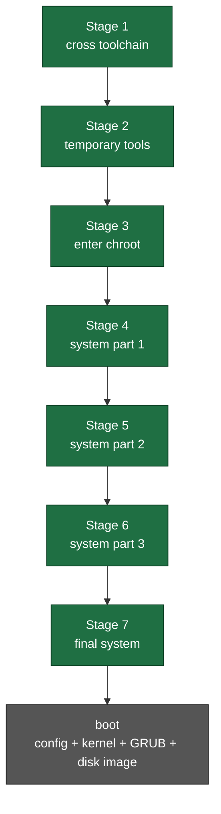
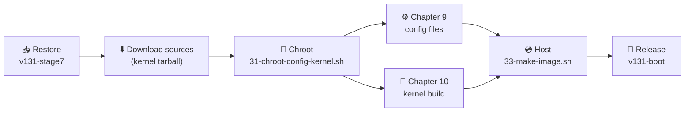

<div align="center">

```text
                       _     _____ ____     _ _____  _
                      | |   |  ___/ ___|   / |___ / / |
                      | |   | |_  \___ \   | | |_ \ | |
                      | |___|  _|  ___) |  | |___) || |
                      |_____|_|   |____/   |_|____(_)_|
```

# 🐧 Linux From Scratch 13.1, built in the cloud, for x86_64

**A complete, reproducible LFS 13.1 (systemd) system for `x86_64`,**
**compiled from source by chained GitHub Actions stages, then packed into a bootable QEMU disk image.**

<br>


<br>

[**Why?**](#-why-does-this-exist) ·
[**How it works**](#-how-it-works) ·
[**Stages**](#-the-stages) ·
[**Boot image**](#-the-boot-stage-chapters-9-and-10) ·
[**Try it**](#-try-it-yourself) ·
[**13.0 → 13.1**](#-whats-different-from-130) ·
[**Lessons**](#-lessons-learned-the-bugs-that-bit-us) ·
[**Roadmap**](#-roadmap)

</div>

---

## 📑 Table of contents

- [TL;DR](#-tldr)
- [Why does this exist?](#-why-does-this-exist)
- [What you get](#-what-you-get)
- [How it works](#-how-it-works)
- [The stages](#-the-stages)
- [The boot stage (chapters 9 and 10)](#-the-boot-stage-chapters-9-and-10)
- [Repository layout](#-repository-layout)
- [Try it yourself](#-try-it-yourself)
- [Verify it](#-verify-it-dont-trust-check)
- [What's different from 13.0](#-whats-different-from-130)
- [Lessons learned: the bugs that bit us](#-lessons-learned-the-bugs-that-bit-us)
- [Honest limitations](#-honest-limitations)
- [Roadmap](#-roadmap)
- [FAQ](#-faq)
- [Credits and licensing](#-credits-and-licensing)

---

## ⚡ TL;DR

> [!NOTE]
> **Linux From Scratch (LFS)** is a book that teaches you to build a Linux system by compiling every
> piece yourself. This branch turns the **13.1 (systemd)** edition of that book into a **pipeline**:
> you click *Run workflow* on GitHub, and a runner builds the system stage by stage, saving each
> result as a downloadable release. A final `boot` workflow adds the configuration, a kernel and a
> bootloader, and produces a **disk image you can start in QEMU**.

- 📘 Built **from source**, following the LFS **13.1-systemd** book (toolchain: GCC 16.2.0, glibc 2.44)
- 🧱 **Chained stages**: each stage restores the previous tarball, builds on top, and publishes a new one
- 🏷️ Release tags are namespaced `v131-*`, so they never collide with the older 13.0 builds
- 💾 Final output: a compressed raw **BIOS-bootable disk image** plus the kernel
- 🆓 Runs on GitHub's free tier for a **public** repository

> [!IMPORTANT]
> This is the `LFS-13.1` branch. The older **13.0 / ARM64 (aarch64)** project lives on `main`; the
> scripts here still contain its `aarch64` branches, but this branch is built and booted as **x86_64**.

---

## 🎯 Why does this exist?

Most people meet Linux as a finished product. LFS is the opposite: you build the compiler, the C
library, the shell and every tool by hand, and you learn what a distribution actually *is*. That is
great for understanding, but it has real costs: hours of compiling, a Linux machine to do it on, and
a build that only exists on one computer.

| 🎯 Goal | What it means here |
|---|---|
| **Learn how Linux is assembled** | Every package is built in the book's order, so each stage maps to chapters you can read. |
| **No build machine required** | The whole build runs on GitHub's runners. You only need a browser to start it. |
| **Reproducibility** | Sources come from the book's own `wget-list` and are checked against its `md5sums`. Anyone can rerun the pipeline. |
| **Stay current** | The branch tracks the newest LFS: a major toolchain jump (GCC 16, glibc 2.44, OpenSSL 4, Linux 7.1). |
| **Make LFS shareable** | A finished system is one `.img.zst` file, not a weekend of someone's terminal history. |
| **Beat the job time limit** | A single CI job is capped at 6 hours. Splitting the build into stages, each saved as a release, makes a long build possible. |

### 🚫 What it is *not*

> [!WARNING]
> This is a **learning and tooling project**, not a daily-driver operating system. The image is a
> minimal LFS system with a kernel built for **QEMU guests**, not for your laptop's hardware. And at
> the time of writing, the boot stage is **written but not yet verified by a run** (see
> [Honest limitations](#-honest-limitations)).

---

## 📦 What you get

| Component | Version / detail |
|---|---|
| Book followed | Linux From Scratch **13.1-systemd** |
| Architecture | **x86_64** |
| C library | **glibc 2.44** |
| Compiler | **GCC 16.2.0**, binutils 2.47 |
| Kernel | **Linux 7.1.8** (`defconfig` + `kvm_guest.config` + the book's §10.3 options) |
| Init system | **systemd 261.2** |
| Notable packages | Python 3.14.7, Perl 5.44.0, OpenSSL 4.0.1, Meson 1.12.0, D-Bus 1.16.2 |
| Bootloader | GRUB (BIOS / MBR), installed with the CI host's `grub-install` |
| Final artifact | `lfs-13.1-x86_64.img.zst`, plus the kernel (`vmlinuz-*`), on the `v131-boot` release |

---

## 🛠 How it works

### The big picture


### Why chained tarballs?



Each arrow is a **release asset**. If a stage fails, you fix one script and rerun *that stage only*,
starting from the last good tarball. Nothing before it is rebuilt.

### The two halves of an LFS build

| Phase | Book chapters | Runs where | What happens |
|---|---|---|---|
| **Outside** the new system | 5 and 6 | the runner itself | Build a cross toolchain and temporary tools into `/mnt/lfs`. |
| **Inside** the new system | 7 and 8 | a **chroot** of `/mnt/lfs` | Enter the half-built system and build the final packages with its own tools. |
| **Make it bootable** | 9 and 10 | chroot, then the host | Configure the system, build the kernel, and write a disk image with GRUB. |

### Release tags

| Tag | Contents |
|---|---|
| `v131-stage1` … `v131-stage7` | `stageN.tar.zst`, the root filesystem after each stage |
| `v131-boot` | `lfs-13.1-x86_64.img.zst` and `vmlinuz-*` |

---

## 🧩 The stages

| # | Stage | Book chapter | What it builds | Status |
|:-:|---|:-:|---|:-:|
| 1 | Cross toolchain | 5 | binutils (pass 1), GCC (pass 1), Linux API headers, glibc, libstdc++ | ✅ |
| 2 | Temporary tools | 6 | M4, Ncurses, Bash, Coreutils, Diffutils, File, Findutils, Gawk, Grep, Gzip, Make, Patch, Sed, Tar, Xz, binutils (pass 2), GCC (pass 2) | ✅ |
| 3 | Enter the chroot | 7 | Gettext, Bison, Perl, Zlib, mpdecimal, Python, Texinfo, Util-linux | ✅ |
| 4 | System, part 1 | 8 | man-pages, iana-etc, glibc, zlib, bzip2, xz, lz4, zstd, file, readline, pcre2, m4, bc, flex, tcl, expect, dejagnu, ninja, pkgconf, binutils, gmp, mpfr, mpc, attr, acl | ✅ |
| 5 | System, part 2 | 8 | libcap, libxcrypt, shadow, gawk, GCC, ncurses, sed, psmisc, gettext, bison, grep, bash, libtool, gdbm, gperf, expat, inetutils, less, perl, autoconf, automake, openssl, libelf, libffi | ✅ |
| 6 | System, part 3 | 8 | sqlite, Python, flit-core, packaging, wheel, setuptools, ninja, meson, kmod, coreutils, diffutils, findutils, groff, grub, gzip, iproute2, kbd, libpipeline | ✅ |
| 7 | Final system | 8 | make, patch, tar, texinfo, vim, MarkupSafe, Jinja2, **systemd**, D-Bus, man-db, procps-ng, util-linux, e2fsprogs, stripping, cleanup | ✅ |
| ★ | **Boot** | 9 and 10 | system configuration, **Linux 7.1.8**, GRUB, disk image | ✅ |

<details>
<summary><b>🔍 How a failure is reported (click to expand)</b></summary>

<br>

The chapter 8 build scripts keep going after a failed package and print one summary line at the end,
so a single run shows **every** broken package instead of stopping at the first:

```text
==> Building tar...
FAILED: tar (exit 2), last lines of log:
...
==> Stage 7 finished WITH FAILURES: tar texinfo
```

Logs for every package are uploaded as a workflow artifact even when the stage fails.

</details>

---

## 🥾 The boot stage (chapters 9 and 10)

The `boot` workflow starts from the `v131-stage7` release and does everything the book does after
chapter 8, scripted for CI.



| Step | Script | What it does |
|---|---|---|
| Enter chroot | `30-chroot-setup-boot.sh` | Mounts `/dev`, `/proc`, `/sys`, `/run` and runs the next script inside the chroot. |
| Configure + kernel | `31-chroot-config-kernel.sh` | Writes the chapter 9 files, sets the root password, writes `fstab`, then configures, builds and installs the kernel. |
| Unmount | `32-unmount-boot.sh` | Unmounts the virtual file systems and collects logs. |
| Disk image | `33-make-image.sh` | Creates a partitioned image, copies the rootfs, repairs ownership, installs GRUB, compresses. |

### ⚙️ Chapter 9: configuration

Hostname, `/etc/hosts`, DHCP through `systemd-networkd` (matching any `en*` interface), the
`systemd-resolved` stub `resolv.conf` symlink, locale, `/etc/profile`, `/etc/inputrc`, `/etc/shells`,
`/etc/vconsole.conf` and `os-release`. Commands that need a running system (`timedatectl`,
`localectl`) are skipped; the files they would write are written directly.

### 🐧 Chapter 10: the kernel

There is no `make menuconfig` in CI, so the configuration is built non-interactively:

1. `make defconfig`, then `make kvm_guest.config` (virtio drivers for QEMU).
2. The options from the book's §10.3 are set with `scripts/config`: `WERROR` off, `PSI`, cgroups,
   `DEVTMPFS`, `SimpleDRM` + framebuffer console, x2APIC, PCI MSI, IRQ remapping, NVMe, and so on.
3. A few extras for systemd and QEMU are added (virtio, ext4, serial console), all **built in**, so no
   initramfs is needed.
4. `make olddefconfig` resolves dependencies.
5. The result is **checked before the long compile**: if a required option did not stick, the build
   stops right there with the option names.

### 💿 The disk image

```text
raw disk image, 8 GiB sparse, MBR (msdos) label, disk id 0x4c465331

┌────────────────┬──────────────────────────────────────────────────┐
│ MBR + 1 MiB    │ partition 1: ext4, label "lfsroot", bootable      │
│ gap (GRUB core)│ the whole root filesystem, including /boot       │
└────────────────┴──────────────────────────────────────────────────┘
     sector 0              starts at sector 2048
```

- The kernel finds `/` with `root=PARTUUID=4c465331-01`, which needs **no initramfs**.
- GRUB is installed with the **host's** `grub-install --target=i386-pc` (BIOS), and `grub.cfg` is
  written by hand, following the book's §10.4.5.
- `/tools` and `/sources` are left out of the image.

---

## 🗂 Repository layout

```text
.
├── .github/workflows/
│   ├── stage1.yml … stage7.yml        # one workflow per stage
│   └── boot.yml                       # chapters 9 + 10 and the disk image
├── scripts/
│   ├── 00-host-setup.sh               # installs host tools, creates $LFS layout
│   ├── 01-sources.sh                  # downloads + verifies the LFS sources
│   ├── 02-toolchain.sh                # chapter 5
│   ├── 03-temptools.sh                # chapter 6
│   ├── 04 … 18-*.sh                   # chroot setup / build / unmount for stages 3 to 7
│   ├── 30-chroot-setup-boot.sh        # boot stage: enter the chroot
│   ├── 31-chroot-config-kernel.sh     # boot stage: chapter 9 config + kernel
│   ├── 32-unmount-boot.sh             # boot stage: unmount, collect logs
│   ├── 33-make-image.sh               # boot stage: disk image + GRUB
│   └── fix-perms.sh                   # repairs ownership + setuid bits in a tarball
├── HOW_TO_WORK.md                     # the original 13.0 / ARM64 build guide
├── MAKING_IT_WORK_STAGE7.md           # chroot + proot test notes from the 13.0 / ARM64 build
└── README.md                          # you are here
```

> [!NOTE]
> `HOW_TO_WORK.md` and `MAKING_IT_WORK_STAGE7.md` describe the earlier 13.0 / ARM64 project. They are
> kept for reference; this README is the guide for the 13.1 branch.

---

## 🚀 Try it yourself

### Option A: boot the finished image in QEMU

> [!NOTE]
> This works once the `boot` workflow has run and published `v131-boot`. See the
> [status](#-honest-limitations).

1. Open the **Releases** page and download `lfs-13.1-x86_64.img.zst` from `v131-boot`.
2. Decompress and boot it:

```bash
zstd -d lfs-13.1-x86_64.img.zst

qemu-system-x86_64 -enable-kvm -m 2G -smp 2 \
  -drive file=lfs-13.1-x86_64.img,format=raw,if=virtio \
  -nic user,model=virtio-net-pci
```

Add `-nographic` to use your terminal instead of a window.

3. Log in as `root` with password **`lfs`**, then change it immediately:

```bash
passwd
```

### Option B: build it yourself in the cloud

1. **Fork** this repository and keep it **public** (public repositories get free runner minutes).
2. Go to **Settings → Actions → General → Workflow permissions** and choose *Read and write permissions*.
3. Make sure `.github/workflows/boot.yml` also exists on your **default branch** (see the note below).
4. Open the **Actions** tab and run the workflows **in order**: `stage1` through `stage7`, then `boot`.
   For every run, set **Use workflow from** to `LFS-13.1`.
5. Wait for each stage to finish and publish its release before starting the next.

> [!IMPORTANT]
> Stage *N* downloads the release published by stage *N−1*. Running them out of order, or before the
> previous release exists, fails at the restore step.

> [!TIP]
> GitHub only lists a `workflow_dispatch` workflow in the Actions sidebar if its file exists on the
> **default branch**. If `boot` does not show up, add the same `boot.yml` to `main`, then run it from the
> `LFS-13.1` branch using the *Use workflow from* dropdown.

---

## 🔬 Verify it: don't trust, check

Run these **inside the booted system** (or inside a chroot of the stage 7 tarball):

```bash
uname -r; ldd --version | head -1; gcc --version | head -1; cat /etc/os-release
```

What you should see (expected values, taken from the versions this branch builds):

```text
7.1.8
ldd (GNU libc) 2.44
gcc (GCC) 16.2.0
NAME="Linux From Scratch"
VERSION="13.1-systemd"
```

| Claim | How to check it yourself |
|---|---|
| Kernel is 7.1.8 | `uname -r` |
| glibc 2.44, GCC 16.2.0 | `ldd --version`, `gcc --version` |
| The compiler really works | `echo 'int main(){return 0;}' > t.c && gcc t.c && ./a.out && echo ok` |
| systemd is the init | `ps -p 1 -o comm=` prints `systemd` |
| Networking works | `ip a`, then `ping -c1 8.8.8.8` (QEMU user networking, DHCP) |
| Built in stages | the **Releases** page lists every `v131-stageN` tarball with dates and sizes |
| Sources are scripted | `scripts/01-sources.sh` fetches the book's `wget-list` and checks `md5sums` |

---

## 🔄 What's different from 13.0

13.1 is a large toolchain update. Everything below was handled in the scripts.

### Version changes

| Package | 13.0 | 13.1 |
|---|---|---|
| GCC | 15.2.0 | **16.2.0** |
| binutils | 2.46.0 | **2.47** |
| glibc | 2.43 | **2.44** |
| Linux (headers / kernel) | 6.18.10 | **7.1.8** |
| systemd | 259.1 | **261.2** |
| OpenSSL | 3.6.1 | **4.0.1** |
| Perl | 5.42 | **5.44.0** |
| coreutils | 9.10 | **9.11** |
| kbd | 2.9.0 | **2.10.0** |
| pkgconf | 2.5.1 | **3.0.5** |
| util-linux | 2.41.3 | **2.42.2** |
| xz | 5.8.2 | **5.8.3** |
| expat | 2.7.4 | **2.8.3** |
| attr / acl | 2.5.2 / 2.3.2 | **2.6.0 / 2.4.0** |
| mpc | 1.3.1 | **1.4.1** |
| procps-ng | 4.0.6 | **4.0.7** |

### Patches

| Patch | Status | Why it matters |
|---|---|---|
| `glibc-2.44-upstream_fixes-1.patch` | 🆕 new | Applied to glibc in chapters 5 and 8. |
| `Python-3.14.7-openssl_4-1.patch` | 🆕 new | Python must build against OpenSSL 4. |
| `tar-1.35-acl_fix-1.patch` | 🆕 new | tar 1.35 does not compile against acl 2.4.0 without it. |
| `coreutils-9.11-i18n-1.patch` | ✏️ renamed | Version bump of the existing patch. |
| `kbd-2.10.0-backspace-1.patch` | ✏️ renamed | Version bump of the existing patch. |

### Removed

`XML::Parser` and `intltool` are no longer part of the book (moved to BLFS), so they are no longer built.

---

## 🧠 Lessons learned: the bugs that bit us

Real problems hit while building this branch, and how each was solved. Open any of them.

<details>
<summary><b>🐛 Python had no pip: the OpenSSL 4 patch was missing</b></summary>

<br>

**Symptom:** the Python step failed, then flit-core, packaging, wheel, setuptools and meson all died
with `No module named pip`, and kmod died with `meson: command not found`.

**Cause:** 13.1 builds OpenSSL 4, and Python 3.14.7 needs `Python-3.14.7-openssl_4-1.patch` to build
against it. The 13.0 script had no patch step. The one failing package cascaded into six.

**Fix:** apply the patch before `./configure`, and check `python3 -m pip --version` right after the
install, so a pip failure surfaces in the Python log instead of five packages later.

</details>

<details>
<summary><b>🐛 tar failed against acl 2.4.0</b></summary>

<br>

**Symptom:** `conflicting types for 'acl_get_file_at'` in `xattrs.c`.

**Cause:** acl 2.4.0 now declares functions that tar 1.35 also defines itself.

**Fix:** `tar-1.35-acl_fix-1.patch`, applied before `./configure`.

</details>

<details>
<summary><b>🐛 Recursive <code>chown</code> strips setuid bits and gives files to the runner</b></summary>

<br>

**Symptom:** `su` and `passwd` lost their setuid bit, and large parts of the tree were owned by the
runner user instead of `root`.

**Cause:** each stage's restore step ran `chown -R` on the whole tree. On Linux, `chown` clears the
setuid and setgid bits of executables, and the damage accumulates across stages.

**Fix:** the disk image script repairs it: files with a uid or gid of 1000 or above go back to
`root`, and the setuid bit is restored on `su`, `passwd`, `newgrp`, `gpasswd`, `chfn`, `chsh`,
`expiry`, `chage`, `mount` and `umount`. The proper fix for the stage workflows is to `chown` only the
`sources` folder (see [Roadmap](#-roadmap)).

</details>

<details>
<summary><b>🐛 Release tags collided with the previous version</b></summary>

<br>

**Cause:** the stage workflows published and downloaded plain `stageN` tags. Running them on a new
branch would have overwritten the working 13.0 releases, because releases belong to the repository,
not to a branch.

**Fix:** every publish and download step now uses `v131-stageN` tags.

</details>

<details>
<summary><b>🐛 The workflow was missing from the Actions sidebar</b></summary>

<br>

**Cause:** a `workflow_dispatch` workflow only appears in the sidebar if the file is on the default
branch. `boot.yml` existed only on `LFS-13.1`.

**Fix:** add the same file to `main`, then pick `LFS-13.1` in *Use workflow from* when running.

</details>

<details>
<summary><b>🐛 Hardcoded library names go stale between releases</b></summary>

<br>

**Cause:** the stripping step named `libbfd-2.46.0.20260210.so`, `libsframe.so.3.0.0` and
`libstdc++.so.6.0.34`. A new binutils or GCC changes these names, and the step silently skipped any file
that was not there.

**Fix:** the names are now found by pattern (`libbfd-*.so`, `libstdc++.so.6.0.[0-9]*`, ...).

</details>

<details>
<summary><b>🐛 A line-number <code>sed</code> in binutils pass 2</b></summary>

<br>

**Cause:** the book edits a fixed line of `ltmain.sh` (`sed '6031s/$add_dir//'`). The line number can
move between releases, and a wrong number would edit nothing and say nothing.

**Fix:** the script checks that line 6031 really contains `$add_dir`, and stops with a clear message
and the matching lines if not.

</details>

<details>
<summary><b>🐛 The kernel build can fail on warnings (<code>WERROR</code>)</b></summary>

<br>

**Cause:** a default kernel configuration can compile with warnings as errors, which breaks on a new
compiler. The book's §10.3 tells you to turn it off.

**Fix:** `WERROR` is disabled, and the configuration is verified before the long compile.

</details>

<details>
<summary><b>🐛 Module signing would pull in OpenSSL 4 build tools</b></summary>

<br>

**Cause:** the kernel's signing and key-ring helper tools are compiled against the system OpenSSL,
which is now version 4.

**Fix:** module signing and the key rings are switched off in the kernel configuration. This is a
precaution, not a confirmed failure.

</details>

---

## 🧭 Honest limitations

> [!CAUTION]
> Please read this before sharing the project or making claims about it.

- ⏳ **The boot stage has not been verified by a run.** The `boot` workflow and its scripts are written
  and syntax-checked, but until it has run and the image has booted in QEMU, treat "it boots" as
  **unproven**.
- 🧪 **The kernel is tuned for QEMU guests**, not for real hardware. It has no drivers chosen for a
  specific laptop, GPU or Wi-Fi card.
- 🖥️ **BIOS only.** LFS builds GRUB without EFI support, so there is no UEFI boot. Adding it means
  rebuilding GRUB for EFI.
- 🔑 **The image has a known root password** (`lfs`). It is a test image: change it on first login.
- 📏 **GitHub release assets are capped at 2 GiB.** If the compressed image is larger, the release step
  fails, and the image is only available as a workflow artifact for a few days.
- 🧱 **GRUB is installed by the CI host's `grub-install`**, not by the LFS-built GRUB.
- ⚠️ **The stage 1 to 7 workflows still run a recursive `chown` on restore.** The image script
  repairs the damage, but the tarballs themselves carry the wrong ownership.
- ⚠️ **Not a first.** Automating LFS is old. What is specific here is the combination: staged release
  tarballs, a build driven entirely through GitHub Actions, and a bootable image at the end.

---

## 🗺 Roadmap

- [x] Stages 1 to 7: cross toolchain through the full LFS 13.1 chapter 8 system
- [x] Port the scripts to 13.1 (new patches, new versions, namespaced release tags)
- [x] Write the boot stage: chapter 9 configuration, kernel, GRUB, disk image
- [ ] **Run the `boot` workflow** and fix whatever it finds
- [ ] **Boot the image in QEMU** and run the checks above
- [ ] Publish SHA-256 checksums in every release
- [ ] Fix the stage 1 to 7 workflows so they stop running a recursive `chown`
- [ ] *(Optional)* UEFI boot (rebuild GRUB for EFI, add the book's UEFI kernel options)
- [ ] *(Optional)* a kernel configuration for real hardware
- [ ] *(Optional)* a small BLFS set for real use
- [ ] Merge the finished work back to `main`

---

## ❓ FAQ

<details>
<summary><b>Is this the first LFS built on GitHub Actions?</b></summary>

<br>

Unknown, and I do not claim it. Automating LFS builds has been done for years. The claim is only what
can be shown: this pipeline exists, builds LFS 13.1 in chained stages, and has a workflow that
produces a bootable image.

</details>

<details>
<summary><b>Why x86_64 on this branch, when the first project was ARM64?</b></summary>

<br>

The `main` branch targets ARM64 (phones, single-board computers). This branch exists to get a complete,
bootable LFS 13.1 first, and x86_64 can be tested directly in QEMU with KVM on a normal PC.

</details>

<details>
<summary><b>Why is the root password set to <code>lfs</code>?</b></summary>

<br>

LFS has no first-boot setup, and without a password you cannot log in to a test image. It is public
and weak on purpose, so change it with `passwd` right after the first login.

</details>

<details>
<summary><b>Why does the image use the host's GRUB instead of the one LFS built?</b></summary>

<br>

Installing GRUB onto a loop device from inside a chroot in CI is fragile. The host's `grub-install`
writes the boot sector and modules reliably, and `grub.cfg` is written by hand, so the boot logic is the
same as the book's.

</details>

<details>
<summary><b>Does it cost money?</b></summary>

<br>

For a **public** repository, GitHub's included minutes cover the runs. If you make the repository
private, Free-plan minute limits apply and a GCC build uses a large share of them. Check your own
billing page.

</details>

<details>
<summary><b>Why is it called "from scratch" if it uses GitHub's runner as a host?</b></summary>

<br>

Same as in the book: you always start from *some* host system. LFS builds a new, independent system
from source using that host's tools, and the new system no longer depends on it.

</details>

---

## 📜 Credits and licensing

- 📘 **[Linux From Scratch](https://www.linuxfromscratch.org/)** by Gerard Beekmans and the LFS
  community, whose book this project follows step by step.
- 🧰 Tools: GitHub Actions, GRUB, QEMU, zstd.
- ⚖️ The scripts in this repository are the project's own (add your `LICENSE` file). The book's text
  and code have their own licenses, so please read the LFS license page before redistributing book
  content.
- 🚫 This project is **not affiliated with or endorsed by** the LFS project.

<div align="center">

<br>

**Built by hand, compiled by robots, booted in a VM. 🛠️**

*If this helped you, a ⭐ on the repo is the best thank-you.*

</div>
